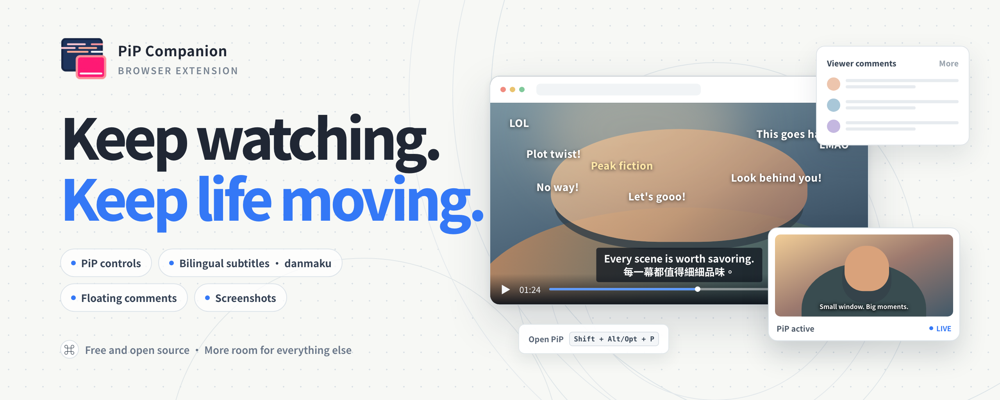

# 幕伴 PiP · PiP Companion

<p align="right">
  <a href="https://chromewebstore.google.com/detail/%E5%B9%95%E4%BC%B4-pip-%C2%B7-pip-companion/gnfofimkbdmkbjejmkdmihdpemlgejlm?utm_source=item-share-cb"></a>
  English | <a href="README.zh-TW.md">繁體中文</a>
</p>

A browser extension that brings web videos into Picture-in-Picture, with subtitles, danmaku, screenshots, and floating comments panels.

<p align="center">
  
</p>

> For problems or feature requests, please report them in [Issues](https://github.com/kir4che/pip-companion/issues).

## Features

- **Picture-in-Picture controls:** play/pause, scrub the timeline, volume, playback speed, frame stepping, play next video, and more.
  - **Volume boost:** same-origin videos can be boosted up to 300%; cross-origin videos may be limited to 100%.
  - **Playback speed:** adjust from 0.25× to 5×; automatically hidden during live streams to preserve sync, and some websites may impose limits.
  - **Progress bar & previews:** keeps the mini progress bar visible at the bottom when controls are hidden, and hovering over the seek bar previews thumbnails (thumbnail previews are supported only on YouTube, Bilibili, and Bahamut Anime Crazy).
  - **Jump to a timestamp:** enter a video time to jump directly to that point.
  - **Bilingual subtitles:** display subtitles that can be read from the video in PiP, with switchable tracks by the languages the video provides.
    - Customizable styles.
    - The second subtitle can use the video's native subtitle track, or live translation via Microsoft Translator, Google Cloud Translation, or DeepL (bring your own API key).
  - **Playlists:** supported on YouTube, Bilibili, and Bahamut Anime Crazy.
- **Danmaku:**
  - Display native danmaku from Bilibili and Bahamut Anime Crazy.
  - Render chat messages from YouTube and Twitch as danmaku.
  - Send danmaku from PiP on Bahamut Anime Crazy, YouTube Live, and Bilibili.
  - Customize danmaku appearance.
  - Additional danmaku: overlay danmaku/chat from Bilibili, Bahamut Anime Crazy, or Twitch onto other videos.
- **Floating comments:** open the comments panel on YouTube and Bilibili video pages while watching.
- **Screenshots:** save the video frame as a PNG file.
- **Follow playback:** when enabled and the PiP source pauses while another page (or the same page) has a playing video, PiP hands off to it. Due to browser restrictions, cross-tab handoff requires a click on that tab.
- **Feature toggles and keyboard shortcuts:** toggle danmaku, screenshots, floating comments, and follow playback individually; customize shortcuts for PiP, comments, screenshots, and danmaku.
- **Localized interface:** Available in Traditional Chinese, Simplified Chinese, and English. Change the language in Settings.
- **Embedded videos:** detect videos in matching iframes. Cross-origin compatibility depends on the website and browser permissions, so not every player is guaranteed to work.

> See [Platform Support and Limitations](docs/platform-support.md) for the platform compatibility matrix.

## Screenshots

| YouTube                                                              | Bilibili                                                               |
| -------------------------------------------------------------------- | ---------------------------------------------------------------------- |
|  |  |

## Controls and Shortcuts

- Open PiP: on a page with a playable video, click **Open PiP** in the extension popup, or press `Shift + Alt/Opt + P` on the page to toggle PiP on or off.
- Customize shortcuts: open the extension’s **All settings** page, select a shortcut in **Shortcuts**, then press a new combination.

| Action                   | Default shortcut          |
| ------------------------ | ------------------------- |
| Open PiP                 | `Shift + Alt/Opt + P`     |
| Play or pause            | `Space`                   |
| Seek (5s by default)     | `←` / `→`                 |
| Adjust volume            | `↓` / `↑`                 |
| Mute                     | `M`                       |
| Subtitles                | `C`                       |
| Fanmaku                  | `D`                       |
| Danmaku input            | `Enter`                   |
| Ffloating comments       | `Alt/Opt + C`             |
| Take screenshot          | `Alt/Opt + P`             |
| Adjust playback speed    | `Shift + ,` / `Shift + .` |
| Step one frame           | `,` / `.`                 |
| Auto-adjust aspect ratio | `R`                       |
| Resize PiP               | `Ctrl/Cmd + scroll wheel` |

## Installation

Requires Chrome 116 or later. From the project directory, run `npm ci` and `npm run build`. Then open `chrome://extensions`, enable Developer mode, and load the `dist/` directory.

## Development

Requires Node.js 22 LTS or later. Install dependencies with `npm ci`, then run:

```bash
npm run lint
npm run typecheck
npm run build
```

## Support

If you enjoy this project, you can buy me a cup of milk tea ヾ(_´∀`_)ﾉ

<a href="https://www.buymeacoffee.com/kir4che" target="_blank"></a>
