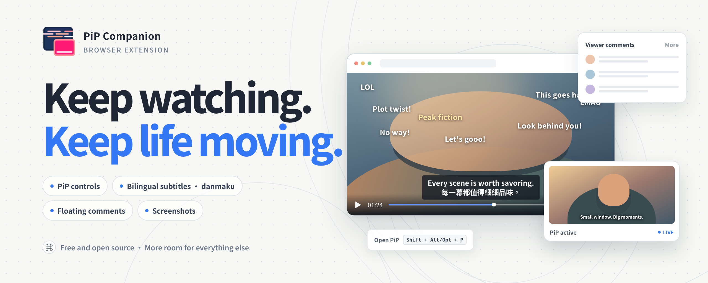
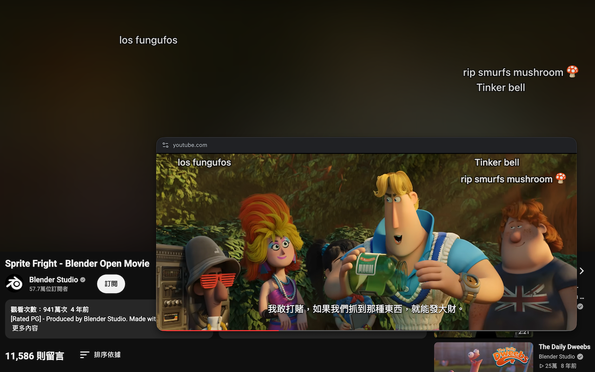
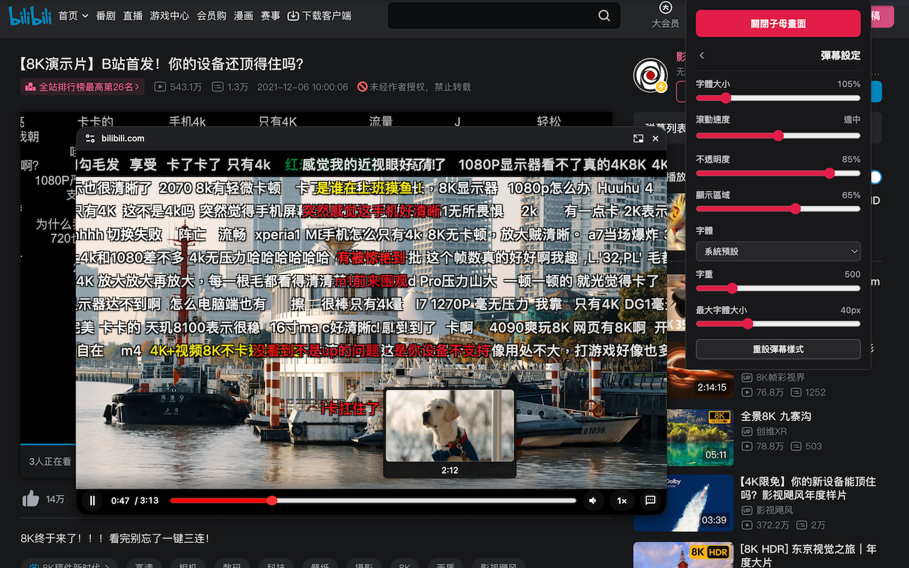
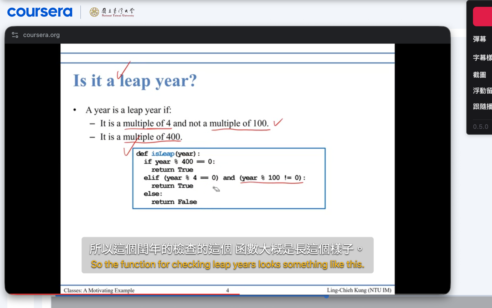
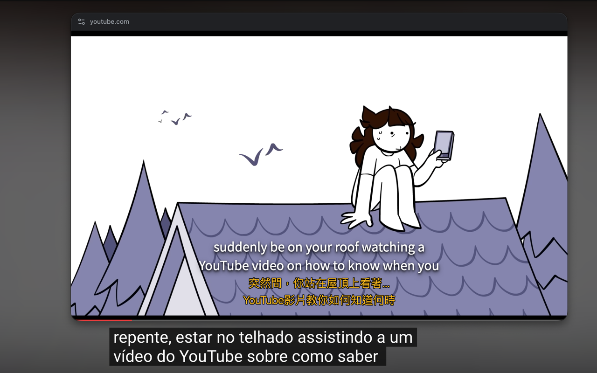
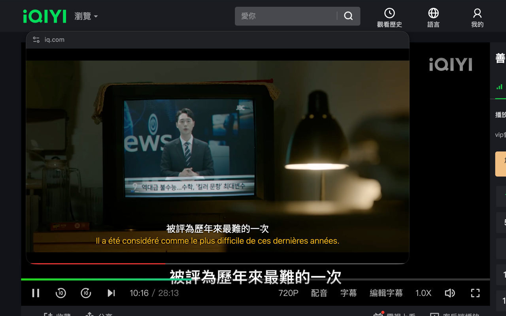
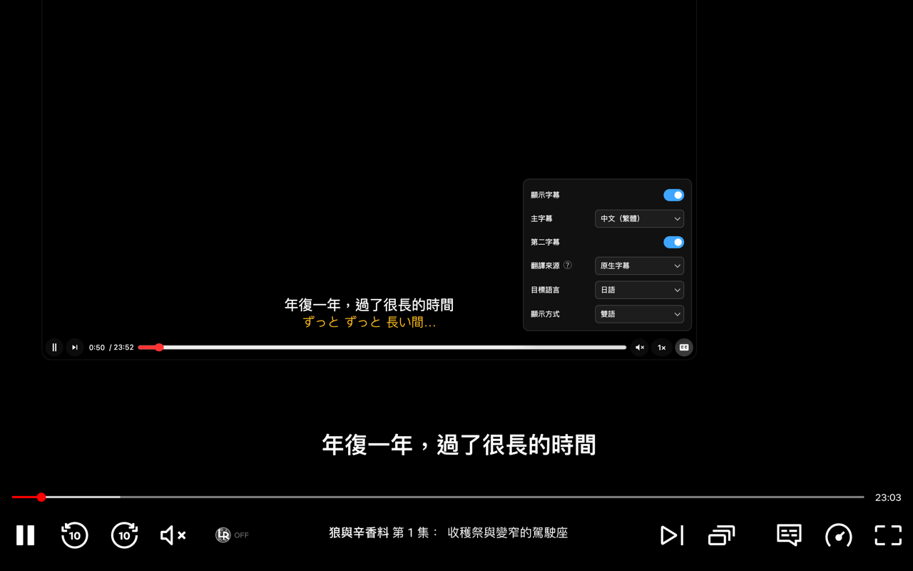
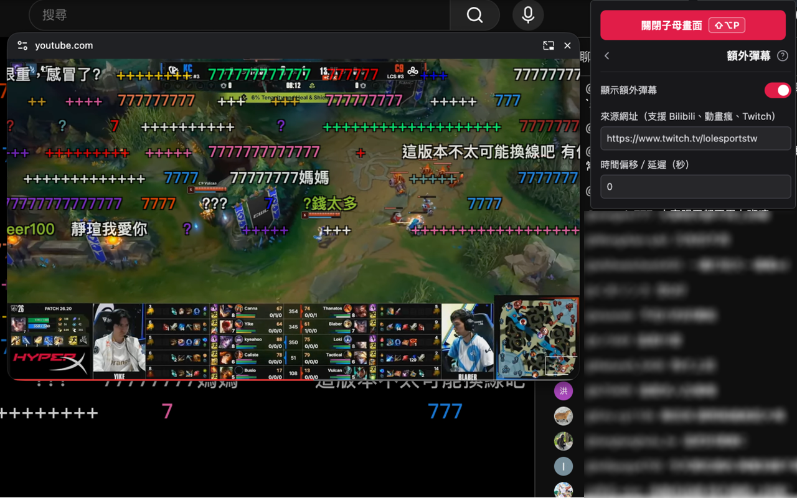

# 幕伴 PiP · PiP Companion

<p align="right">
  <a href="https://chromewebstore.google.com/detail/%E5%B9%95%E4%BC%B4-pip-%C2%B7-pip-companion/gnfofimkbdmkbjejmkdmihdpemlgejlm?utm_source=item-share-cb"></a>
  English | <a href="README.zh-CN.md">简体中文</a> | <a href="README.zh-TW.md">繁體中文</a>
</p>

A browser extension that brings web videos into Picture-in-Picture, with subtitles, danmaku, screenshots, and floating comments panels.

<p align="center">
  
</p>

> For problems or feature requests, please report them in [Issues](https://github.com/kir4che/pip-companion/issues).

## Features

- **Picture-in-Picture (PiP) controls:** play/pause, scrub the timeline, volume, playback speed, frame stepping, play next video, and full controls
  - **Customizable appearance:** customize the primary theme color, and drag to reorder, show, or hide player control items in settings.
  - **Volume boost:** same-origin videos can be boosted up to 300%; cross-origin videos may be limited to 100%.
  - **Playback speed:** adjust playback speed from 0.25 – 5×; automatically hidden during live streams to preserve sync, and some websites may impose limits.
  - **Progress bar & previews:** keeps the mini progress bar visible at the bottom when controls are hidden, and hovering over the seek bar previews timeline thumbnails (supports YouTube, Bilibili, Bahamut Anime Crazy, and Netflix).
  - **Jump to timestamp:** enter a video time to jump directly to that point
  - **Bilingual subtitles:** display subtitles in PiP, switch video subtitle tracks, or generate bilingual subtitles with translation services.
    - Built-in free translation, or connect other translation services with your API keys
    - Customizable styles
  - **Playlists** (only supported on YouTube, Bilibili, and Bahamut Anime Crazy)
- **Danmaku:**
  - Display native danmaku from Bilibili and Bahamut Anime Crazy
  - Render chat messages from YouTube and Twitch as danmaku
  - **Danmaku search:** search current danmaku by keyword inside PiP, automatically discover Top 3 highlight timestamps, and click to jump directly to playback.
  - **Auto timestamp jump:** detect timestamp tags in danmaku (e.g., `空降 02:45`, `跳傘7:30`) with clickable jump boxes or opt-in automatic jumping
  - Danmaku input (Bahamut Anime Crazy, YouTube Live, Bilibili)
  - **Keyword filtering:** filter danmaku using plain text or regular expressions (Regex)
  - **Extra danmaku:** overlay danmaku/chat from Bilibili, Bahamut Anime Crazy, Twitch, or YouTube onto other videos
  - Customizable styles
- **Floating comments:** expand YouTube and Bilibili comment sections into a floating panel to browse comments while watching videos.
- **Screenshots:** save the video frame as a PNG
- **Follow playback:** when enabled, if the PiP source pauses while another page (or the same page) has a playing video, PiP hands off to it. Due to browser restrictions, cross-tab handoff requires a click on that tab.
- **Feature toggles & shortcuts:** toggle danmaku, screenshots, floating comments, and follow playback individually; customize shortcuts for toggling PiP, comments, screenshots, danmaku, and danmaku search.
- **Multilingual interface:** supports Traditional Chinese, Simplified Chinese, and English; can be switched in settings.
- **Embedded videos:** detect eligible iframe videos. Cross-origin compatibility depends on website structure and browser permissions, so not all players are guaranteed to work.

> See [Platform Support and Limitations](docs/platform-support.md) for platform compatibility and details.

## Screenshots

| YouTube                                                              | Bilibili                                                               |
| -------------------------------------------------------------------- | ---------------------------------------------------------------------- |
|  |  |

### Bilingual subtitles across platforms

| Coursera                                                                                             | YouTube                                                                                                                       |
| ---------------------------------------------------------------------------------------------------- | ----------------------------------------------------------------------------------------------------------------------------- |
|  |                             |
| iQIYI                                                                                                | Netflix                                                                                                                       |
|        |  |

### Extra danmaku

| YouTube with Twitch extra danmaku                                                                              |
| -------------------------------------------------------------------------------------------------------------- |
|  |

## Controls and Shortcuts

- Open PiP: on supported platforms, press `Shift + Alt/Opt + P` or click the "Open PiP" button in the extension menu.
- Customize shortcuts: open the extension's "All settings" page, click a shortcut in "Shortcuts", then press a new combination.

| Action                   | Default shortcut          |
| ------------------------ | ------------------------- |
| Open PiP                 | `Shift + Alt/Opt + P`     |
| Play / Pause             | `Space`                   |
| Seek (5s by default)     | `←` / `→`                 |
| Adjust volume            | `↓` / `↑`                 |
| Mute                     | `M`                       |
| Subtitles                | `C`                       |
| Danmaku                  | `D`                       |
| Danmaku input            | `Enter`                   |
| Danmaku search           | `Ctrl/Cmd + F`            |
| Floating comments        | `Alt/Opt + C`             |
| Take screenshot          | `Alt/Opt + P`             |
| Adjust playback speed    | `Shift + ,` / `Shift + .` |
| Step one frame           | `,` / `.`                 |
| Auto-adjust aspect ratio | `R`                       |
| Resize PiP               | `Ctrl/Cmd + scroll wheel` |

## Installation

Requires Chrome 116 or later. Run `npm ci` and `npm run build` in the project directory, then go to `chrome://extensions`, enable "Developer mode", and load the `dist/` directory.

## Development

Requires Node.js 22 LTS or later. First run `npm ci` to install dependencies, then use the following commands:

```bash
npm run lint
npm run typecheck
npm run build
```

## Support

If you enjoy this project, you can buy me a cup of milk tea ヾ(_´∀`_)ﾉ

[](https://ko-fi.com/kir4che)
