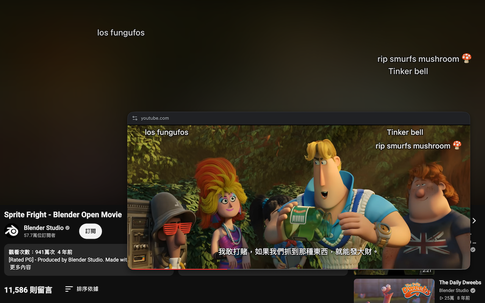
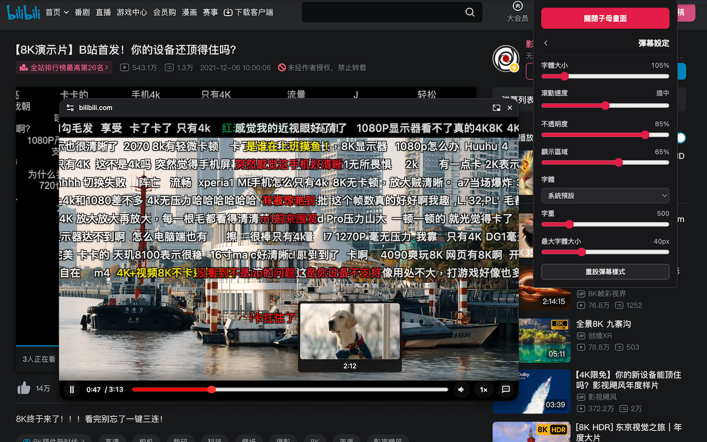
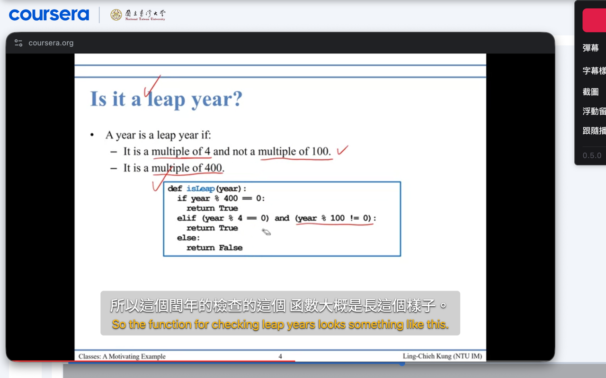
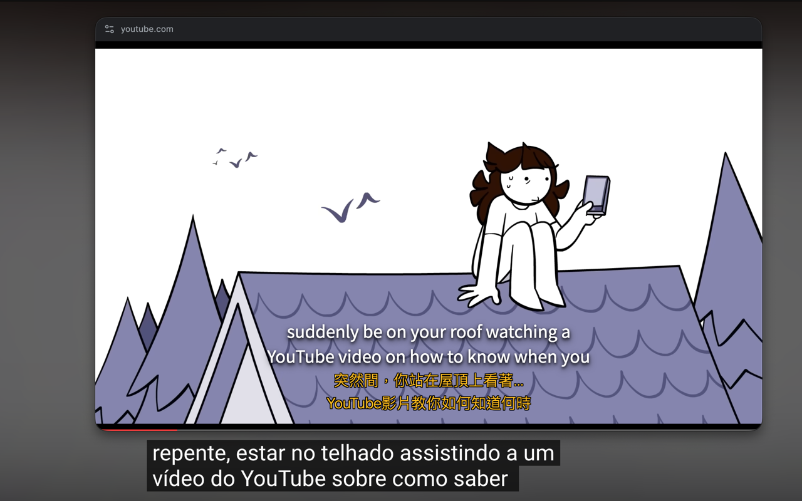
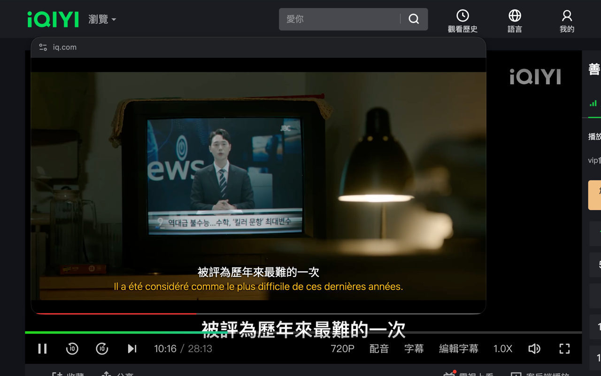
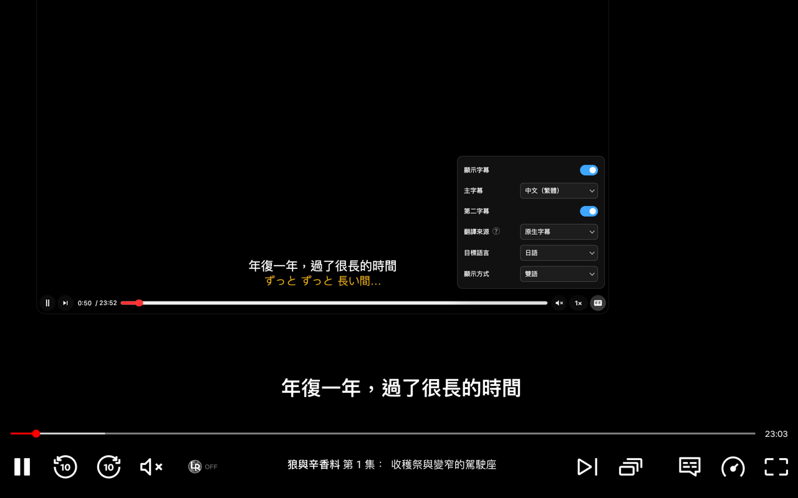
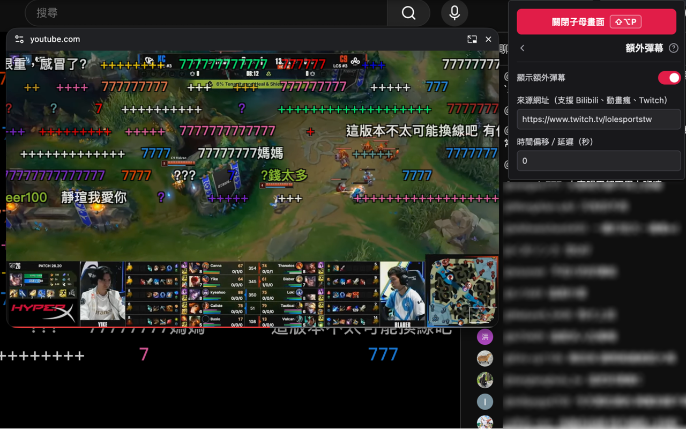

# 幕伴 PiP · PiP Companion

<p align="right">
  <a href="https://chromewebstore.google.com/detail/%E5%B9%95%E4%BC%B4-pip-%C2%B7-pip-companion/gnfofimkbdmkbjejmkdmihdpemlgejlm?utm_source=item-share-cb"></a>
  <a href="README.md">English</a> | 简体中文 | <a href="README.zh-TW.md">繁體中文</a>
</p>

让网页视频在画中画（PiP）中播放，支持字幕、弹幕、截图与浮动评论区。

<p align="center">
  
</p>

> 遇到问题或有功能建议，请到 [Issues](https://github.com/kir4che/pip-companion/issues) 反馈。

## 功能

- **画中画（PiP）控制**：播放／暂停、进度条拖拽、音量、倍速、逐帧、播放下集等完整控制
  - **外观自定义**：可自定义主配色，并在设置页拖拽调整播放栏各个功能的排序与显示／隐藏。
  - **音量放大**：同源视频最高可提高至 300%；跨源视频可能仅支持至 100%。
  - **倍速播放**：可将播放速度调整至 0.25 – 5×；在直播中会自动隐藏倍速按钮以保持同步，且部分网站可能会限制。
  - **进度条与预览**：控制栏隐藏时底部仍常驻显示迷你进度条，鼠标悬停可预览时间轴缩略图（支持 YouTube、Bilibili、巴哈动画疯、Netflix）。
  - **输入时间跳转**：可直接输入视频时间并跳转至该时间点
  - **双语字幕**：PiP 中显示字幕，可切换视频字幕轨，或用翻译服务产生双语。
    - 内建免费翻译，亦可用 API Key 接其他翻译服务
    - 样式自定义
  - **播放列表**（仅支持 YouTube、Bilibili 与巴哈动画疯）
- **弹幕**：
  - 原生弹幕（Bilibili、巴哈动画疯）显示
  - 聊天室（YouTube、Twitch）转弹幕并显示
  - **弹幕搜索**：以关键字搜索当前视频的弹幕，并自动分析标注热门弹幕 Top 3 时间标签。
  - **自动空降**：识别弹幕中的时间戳记（如 `空降 02:45`、`跳伞7:30`）并可点击跳转或自动跳转至该时间
  - 弹幕输入（巴哈动画疯、YouTube 直播、Bilibili）
  - **关键字过滤**：可设置纯文本或正则表达式（Regex）过滤弹幕
  - **额外弹幕**：可将 Bilibili、巴哈动画疯、Twitch 或 YouTube 的弹幕／聊天室叠加到其他视频上
  - 样式自定义
- **浮动评论区**：将 YouTube、Bilibili 评论区展开为浮动面板，观看视频时也能浏览评论。
- **截图**：将视频画面保存为 PNG
- **视频跟随**：开启后，当 PiP 来源暂停，而其他页面（或同页）有视频正在播放时，会将 PiP 交接过去；受浏览器限制，跨标签页交接需在该标签页点一下。
- **功能开关与快捷键**：可分别开关弹幕、截图、浮动评论区与视频跟随功能，并自定义“开关 PiP、评论区、截图、弹幕与弹幕搜索”快捷键。
- **多语言界面**：支持繁体中文、简体中文与英文，可在设置页切换。
- **嵌入视频**：检测符合条件的 iframe 视频；跨网域兼容性仍受网站结构与浏览器权限影响，无法保证所有播放器都能使用。

> 各平台支持与限制请参阅[平台支持对照](docs/platform-support.zh-CN.md)

## 画面预览

| YouTube                                                   | Bilibili                                                    |
| --------------------------------------------------------- | ----------------------------------------------------------- |
|  |  |

### 双语字幕跨平台示范

| Coursera                                                                         | YouTube                                                                                                     |
| -------------------------------------------------------------------------------- | ----------------------------------------------------------------------------------------------------------- |
|  |                               |
| 爱奇艺                                                                           | Netflix                                                                                                     |
|        |  |

### 额外弹幕示范

| YouTube + Twitch 额外弹幕                                                                    |
| -------------------------------------------------------------------------------------------- |
|  |

## 操作与快捷键

- 开启画中画：在支持的平台可按 `Shift + Alt/Opt + P`，或点选扩展程序菜单中的“开启画中画”按钮。
- 自定义快捷键：开启扩展程序的“所有设置”页面，在“快捷键”区点选要修改的快捷键，再按下新的组合。

| 操作              | 默认快捷键                |
| ----------------- | ------------------------- |
| 开启画中画        | `Shift + Alt/Opt + P`     |
| 播放／暂停        | `Space`                   |
| 跳转（默认 5 秒） | `←` / `→`                 |
| 调节音量          | `↓` / `↑`                 |
| 静音              | `M`                       |
| 字幕              | `C`                       |
| 弹幕              | `D`                       |
| 弹幕输入          | `Enter`                   |
| 弹幕搜索          | `Ctrl/Cmd + F`            |
| 浮动评论区        | `Alt/Opt + C`             |
| 截图              | `Alt/Opt + P`             |
| 调节播放速度      | `Shift + ,` / `Shift + .` |
| 逐帧播放          | `,` / `.`                 |
| 自动调整比例      | `R`                       |
| 调整 PiP 大小     | `Ctrl/Cmd + 滚轮`         |

## 安装

需要 Chrome 116 或更新版本，在项目目录执行 `npm ci`、`npm run build`，接着前往 `chrome://extensions`，开启“开发者模式”，并加载 `dist/` 文件夹。

## 开发

需要 Node.js 22 LTS 或更高版本，先执行 `npm ci` 安装依赖，再使用以下命令：

```bash
npm run lint
npm run typecheck
npm run build
```

## 支持

如果你喜欢这个项目，欢迎赞助我一杯奶茶 ヾ(_´∀`_)ﾉ

[](https://ko-fi.com/kir4che)
