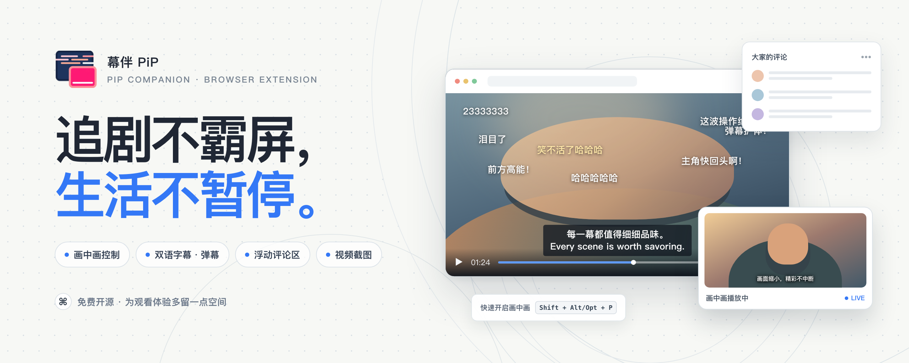
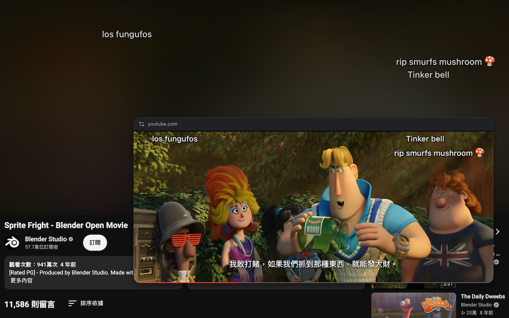
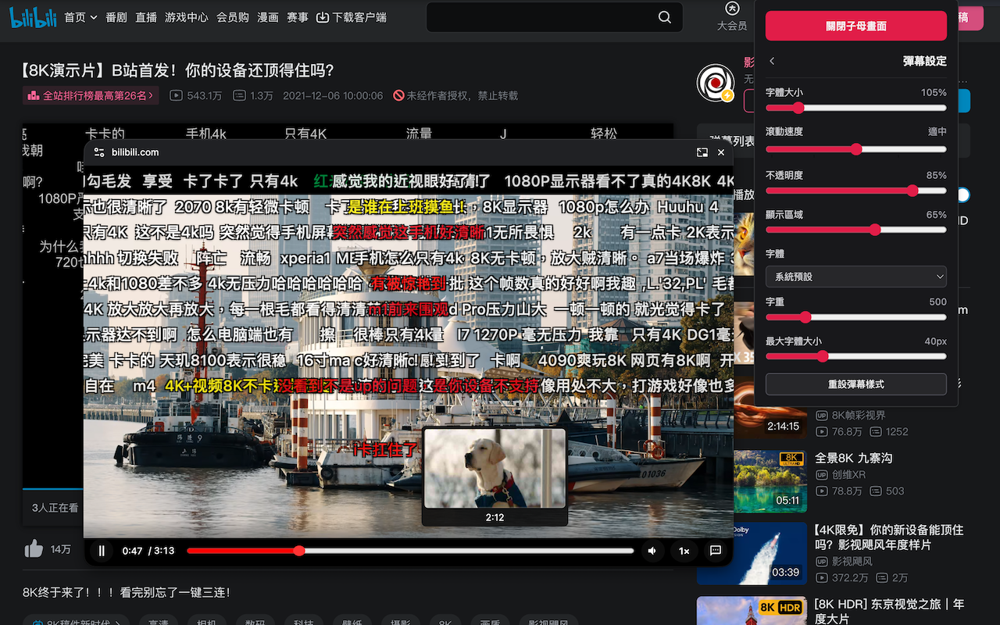
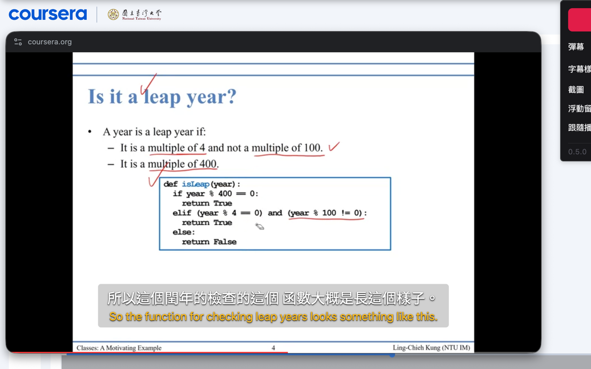
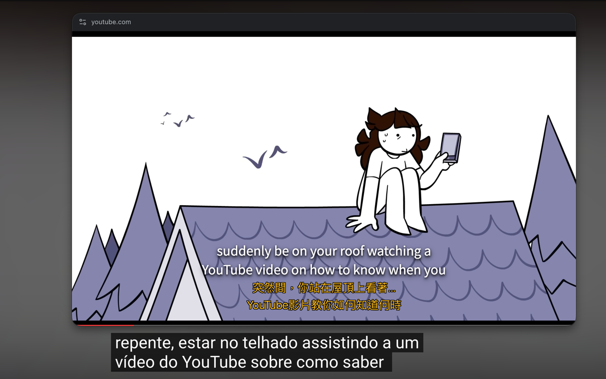
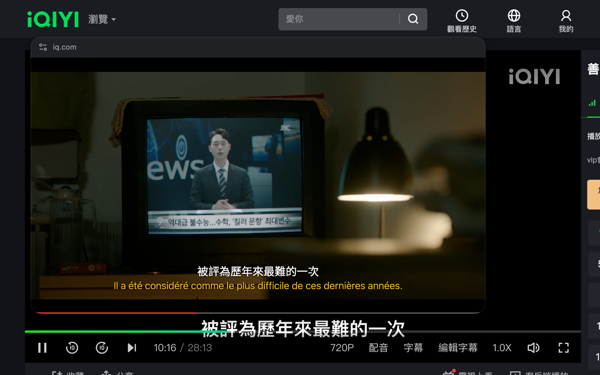
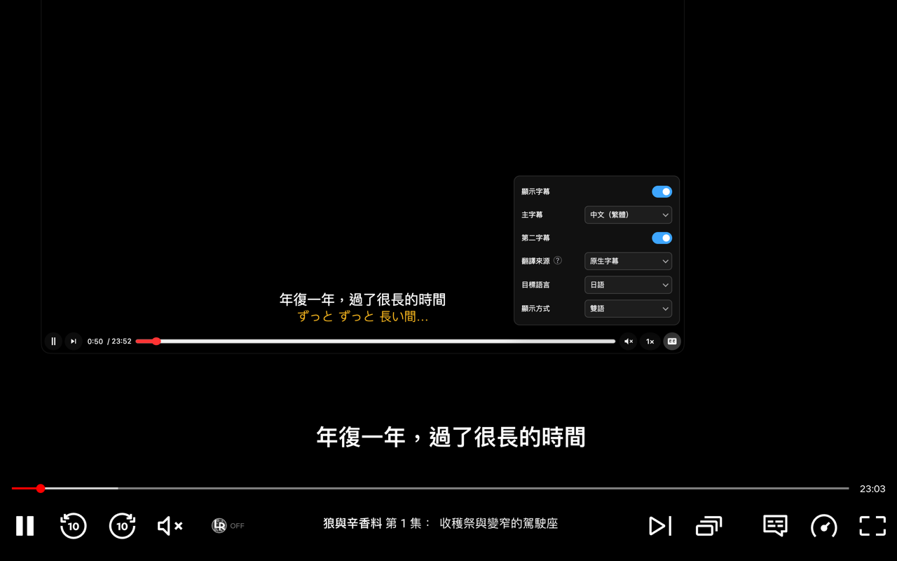
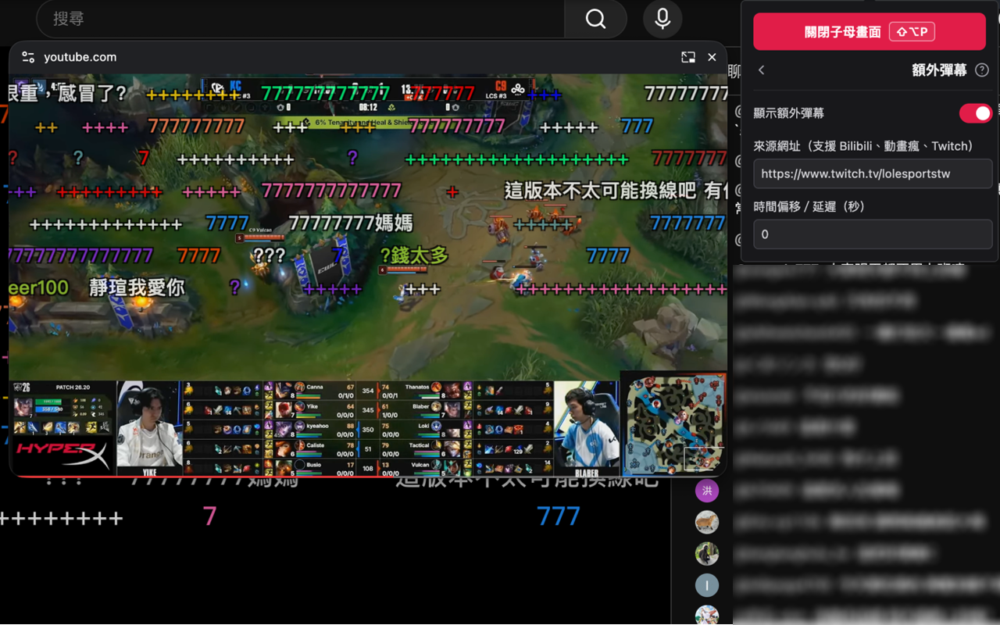

# 幕伴 PiP · PiP Companion

<p align="right">
  <a href="https://chromewebstore.google.com/detail/%E5%B9%95%E4%BC%B4-pip-%C2%B7-pip-companion/gnfofimkbdmkbjejmkdmihdpemlgejlm?utm_source=item-share-cb"></a>
  <a href="README.md">English</a> | 简体中文 | <a href="README.zh-TW.md">繁體中文</a>
</p>

让网页视频在画中画（PiP）窗口中播放，支持字幕、弹幕、截图和浮动评论区。

<p align="center">
  
</p>

> 遇到问题或有功能建议，请到 [Issues](https://github.com/kir4che/pip-companion/issues) 反馈。

## 功能

- **画中画（PiP）控制**：播放／暂停、拖动进度条、调节音量和倍速、逐帧播放、播放下一个视频等。
  - **音量增强**：同源视频最高可提升至 300%；跨源视频可能仅支持至 100%。
  - **倍速播放**：可将播放速度调整至 0.25–5×；直播时会自动隐藏倍速按钮以保持同步，部分网站可能会限制倍速。
  - **进度条与预览**：控制栏隐藏时，底部仍会显示迷你进度条；将鼠标悬停在进度条上可预览缩略图（仅支持 YouTube、Bilibili 和巴哈姆特动画疯）。
  - **输入时间跳转**：直接输入视频时间即可跳转到对应位置。
  - **双语字幕**：在 PiP 中显示视频可读取的字幕，并可切换视频提供的字幕轨道。
    - 支持自定义字幕样式。
    - 第二条字幕可使用视频原生字幕轨道，也可通过 Microsoft Translator、Google Cloud Translation 或 DeepL 实时翻译（需自备 API 密钥）。
  - **播放列表**：支持 YouTube、Bilibili 和巴哈姆特动画疯。
- **弹幕**：
  - 显示 Bilibili 和巴哈姆特动画疯的原生弹幕。
  - 将 YouTube 和 Twitch 聊天室消息显示为弹幕。
  - 在巴哈姆特动画疯、YouTube 直播和 Bilibili 中发送弹幕。
  - 支持自定义弹幕样式。
  - **额外弹幕**：可将 Bilibili、巴哈姆特动画疯、Twitch 或 YouTube 的弹幕／聊天室消息叠加到其他视频上。
- **浮动评论区**：将 YouTube 或 Bilibili 视频评论区展开为浮动面板，观看视频时也能浏览评论。
- **截图**：将视频画面保存为 PNG 图片。
- **跟随播放**：开启后，如果 PiP 来源暂停，而其他页面（或同一页面）有视频正在播放，PiP 会切换到该视频。受浏览器限制，跨标签页切换需要在目标标签页点击一次。
- **功能开关与快捷键**：可分别开关弹幕、截图、浮动评论区和跟随播放功能，并自定义 PiP、评论区、截图和弹幕的快捷键。
- **多语言界面**：支持简体中文、繁体中文和英文，可在设置页面切换。
- **嵌入视频**：可检测符合条件的 iframe 视频；跨域兼容性取决于网站结构和浏览器权限，无法保证所有播放器都能使用。

> 各平台的支持情况与限制请参阅[平台支持对照](docs/platform-support.zh-CN.md)。

## 画面预览

| YouTube                                                   | Bilibili                                                    |
| --------------------------------------------------------- | ----------------------------------------------------------- |
|  |  |

### 多平台双语字幕示范

| Coursera                                                                         | YouTube                                                                                                     |
| -------------------------------------------------------------------------------- | ----------------------------------------------------------------------------------------------------------- |
|  |                               |
| 爱奇艺                                                                           | Netflix                                                                                                     |
|        |  |

### 额外弹幕示范

| YouTube + Twitch 额外弹幕                                                                    |
| -------------------------------------------------------------------------------------------- |
|  |

## 操作与快捷键

- **开启画中画**：在支持的平台可按 `Shift + Alt/Opt + P`，或点击扩展程序弹窗中的“开启画中画”按钮。
- **自定义快捷键**：打开扩展程序的“所有设置”页面，在“快捷键”区域选择要修改的快捷键，然后按下新的组合键。

| 操作              | 默认快捷键                |
| ----------------- | ------------------------- |
| 开启画中画        | `Shift + Alt/Opt + P`     |
| 播放／暂停        | `Space`                   |
| 跳转（默认 5 秒） | `←` / `→`                 |
| 调节音量          | `↓` / `↑`                 |
| 静音              | `M`                       |
| 字幕              | `C`                       |
| 弹幕              | `D`                       |
| 输入弹幕          | `Enter`                   |
| 浮动评论区        | `Alt/Opt + C`             |
| 截图              | `Alt/Opt + P`             |
| 调节播放速度      | `Shift + ,` / `Shift + .` |
| 逐帧播放          | `,` / `.`                 |
| 自动调整画面比例  | `R`                       |
| 调整 PiP 大小     | `Ctrl/Cmd + 滚轮`         |

## 安装

需要 Chrome 116 或更高版本。在项目目录中运行 `npm ci` 和 `npm run build`，然后打开 `chrome://extensions`，启用“开发者模式”，并加载 `dist/` 文件夹。

## 开发

需要 Node.js 22 LTS 或更高版本。先运行 `npm ci` 安装依赖，再执行以下命令：

```bash
npm run lint
npm run typecheck
npm run build
```

## 支持

如果你喜欢这个项目，欢迎请我喝一杯奶茶 ヾ(_´∀`_)ﾉ

[](https://ko-fi.com/kir4che)
